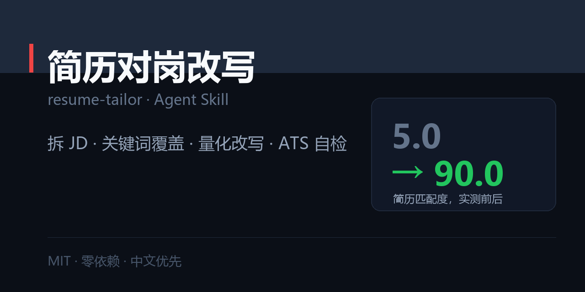

# 简历对岗改写 · resume-tailor

> 把一份简历改到「这个岗位缺的那个人」的样子：JD 拆解 → 关键词覆盖率 → 量化改写 → 可验证自检。



[](./SKILL.md)
[](./LICENSE)
[](#)

职场五件套之一：[`resume-tailor`](https://github.com/zhbehx/resume-tailor) · [`interview-coach`](https://github.com/zhbehx/interview-coach) · [`weekly-report`](https://github.com/zhbehx/weekly-report) · [`slide-story`](https://github.com/zhbehx/slide-story) · [`meeting-actions`](https://github.com/zhbehx/meeting-actions)

---

## 为什么不是「让 AI 美化一下」

| | 直接让 AI 润色 | 用这个 Skill |
| --- | --- | --- |
| 起点 | 从你的措辞出发 | 从 JD 的要求出发 |
| 关键词 | 随缘出现 | 盘点覆盖率，缺哪个补哪个 |
| 成果 | 「负责/参与」改写成「主导/统筹」——换汤不换药 | 每条必须有数字，没有就换算 |
| 判断标准 | 「读起来更专业了」 | 脚本给出覆盖率 / 量化率 / 综合分 |
| 交付 | 一大段文本 | 完整简历 + 逐条改动说明 + 还缺什么 |

它不负责让你听起来更厉害，负责**让 HR 在 20 秒内确认你就是那个候选人**。

---

## 安装

```bash
git clone https://github.com/zhbehx/resume-tailor.git ~/.claude/skills/resume-tailor
```

其他支持 Agent Skills 的客户端：把目录放进它的 skills / rules 目录；只支持单文件的，粘贴 `SKILL.md`。

## 30 秒上手

```
帮我改简历，投这个岗：<粘贴完整 JD>
我的简历：<粘贴简历全文>
```

它会先给你 **JD 拆解表**（硬性/加分/隐性 + 一句话判断），等你确认后再改写——因为拆错方向，后面全白做。

### 你会拿到什么

```markdown
# JD 拆解（先确认）
# 覆盖率盘点：覆盖率 X%｜缺失关键词｜弱动词 N 处
# 改写后的简历（完整可复制）
# 逐条改动说明（原文 / 改写 / 对应 JD 哪一条）
# 还缺什么（最多 3 条）
```

完整示例：[`examples/01-pm-to-growth.md`](./examples/01-pm-to-growth.md)（B 端产品转增长，综合分 **5.0 → 90.0**，覆盖率 0% → 80%）

## 自检脚本

零依赖，Python 3.9+：

```bash
python scripts/check_jd_match.py --jd jd.txt --resume resume.txt

关键词覆盖：100%  （JD 9 个能力词，命中 9 个）
量化率    ：100%  （9/9 条 bullet 含数字）
弱动词    ：0 处
综合评分  ：100/100
```

- `--fail-under 0.6` 覆盖率不达标时退出码 1，可挂进提交流程
- `--json` 输出结构化结果
- 能力词库 `references/skills-lexicon.txt` 是纯文本，**加一行就多一个关键词**

## 核心规则（全部写在 SKILL.md 里）

1. **一页一个岗** —— 投递前必改，通用版只当素材库。
2. **JD 是评分表** —— 拆成硬性 / 加分 / 隐性三类，隐性要求决定排序。
3. **每行一个成果** —— 动词开头 + 一个数字 + 影响范围。
4. **不编造，可换算** —— 频次、规模、时长、比例四类换算方式。
5. **删掉弱动词** —— 负责 / 参与 / 协助 / 配合 = 「我只是在场」。

## 仓库结构

```
resume-tailor/
├── SKILL.md                      # 五条原则 + Step 0–5 + 交付格式 + 反模式
├── references/
│   ├── jd-decode.md              # 三类要求、隐性信号表、ATS 与人筛规则
│   ├── bullet-formulas.md        # 20 条 bullet 公式 + 强弱动词对照 + 无数字换算
│   └── skills-lexicon.txt        # 能力词库（可扩充）
├── scripts/
│   └── check_jd_match.py         # 覆盖率 / 量化率 / 弱动词
└── examples/
    └── 01-pm-to-growth.md        # 完整案例：33% → 100%
```

> `market/social-preview.png` 是本仓的社交预览图（1280×640），用于 README 顶部与分享卡片。改文案后跑 `python market/make_preview.py` 重新生成（需要 Pillow）。

## 自定义

1. **加行业词**：`references/skills-lexicon.txt` 追加 `词|类别`。
2. **换语气**：在 `SKILL.md` 五条原则下加一句人设，如「用户是应届生，别用高层级动词」。
3. **加岗位模板**：把某类岗位的固定结构写进 `references/`，例如「技术岗项目怎么写」。

## FAQ

**Q：没有数据怎么办？**
A：先换算（规模/频次/时长/比例），不要编。真的没有，说明这段经历不该占篇幅，删掉换一段。

**Q：转岗经历不对口会被筛掉吗？**
A：会，所以要做「可迁移翻译」：把旧经历翻译成新岗位的语言（漏斗、指标、实验），并明确说出迁移逻辑。案例里演示了完整做法。

**Q：会不会写成千篇一律的 AI 味？**
A：反了。它主要工作是删：删弱动词、删形容词、删与 JD 无关的内容，并强制每条带数字。

## License

[MIT](./LICENSE)
